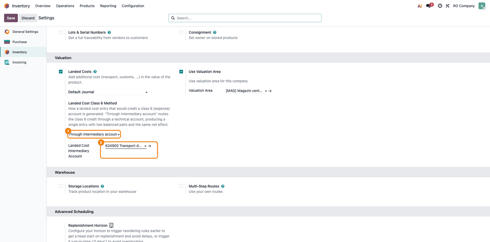
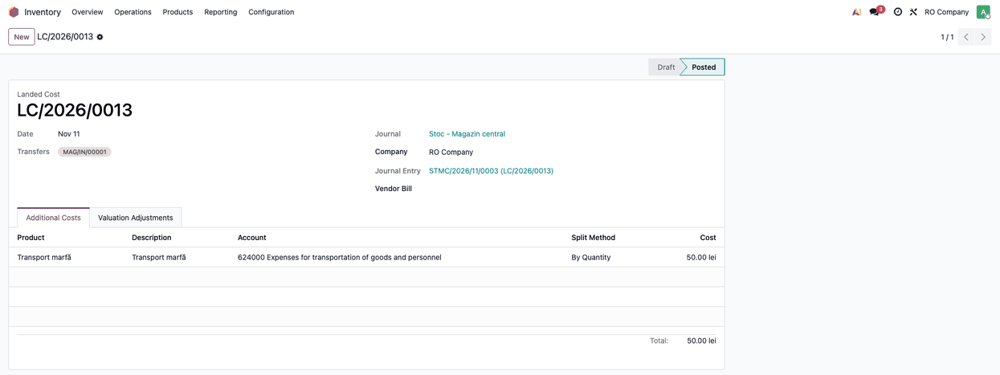
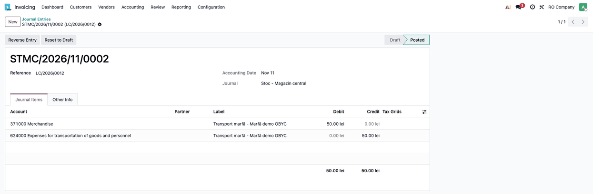
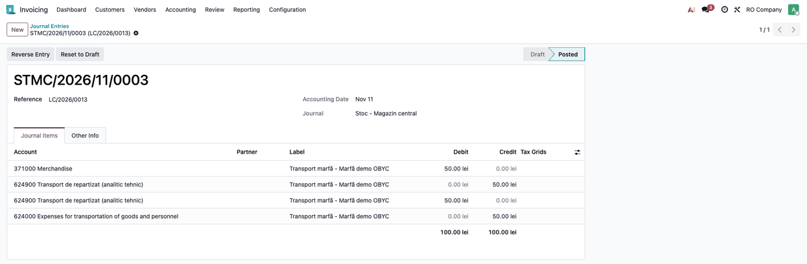

==================================
OBYC - Landed Cost Class 6 Routing
==================================

..
   !!!!!!!!!!!!!!!!!!!!!!!!!!!!!!!!!!!!!!!!!!!!!!!!!!!!
   !! This file is generated by oca-gen-addon-readme !!
   !! changes will be overwritten.                   !!
   !!!!!!!!!!!!!!!!!!!!!!!!!!!!!!!!!!!!!!!!!!!!!!!!!!!!
   !! source digest: sha256:e5e16fd018f0295433abf3534c94cc9ec5d3a8938221855d8fc808eb4bf949d1
   !!!!!!!!!!!!!!!!!!!!!!!!!!!!!!!!!!!!!!!!!!!!!!!!!!!!

.. |badge1| image:: https://img.shields.io/badge/maturity-Beta-yellow.png
    :target: https://odoo-community.org/page/development-status
    :alt: Beta
.. |badge2| image:: https://img.shields.io/badge/github-dhongu%2Fdeltatech_stock_valuation-lightgray.png?logo=github
    :target: https://github.com/dhongu/deltatech_stock_valuation/tree/19.0/deltatech_obyc_landed_cost
    :alt: dhongu/deltatech_stock_valuation
.. |badge_fisa| image:: https://img.shields.io/badge/-Fi%C8%99%C4%83%20consultant-2ea44f.png
    :target: https://github.com/dhongu/deltatech_stock_valuation/blob/19.0/deltatech_obyc_landed_cost/readme/FISA_CONSULTANT.md
    :alt: Fișă consultant

|badge1| |badge2| |badge_fisa|

Landed costs on top of ``deltatech_obyc``. The stock account of a landed
cost comes from the OBYC rule ``landed_cost``; this module adds, per
company, an optional routing of the class 6 credit through a technical
intermediary account, and fills the landed cost created from a vendor
bill.

**Table of contents**

.. contents::
   :local:

Usage
=====

Configuration
-------------

1. Go to *Inventory → Configuration → Settings*, block **Valuation**.
2. Set **Landed Cost Class 6 Method** to *Through intermediary account*
   and choose the **Intermediary Account** (a technical account defined
   by the company accounting policy).
3. Make sure the OBYC rule **Landed Costs** (``landed_cost``) has the
   **Valuation Account** filled.

|Landed cost method setting|

Usage
-----

1. Open *Inventory → Operations → Adjustments → Landed Costs*, create a
   document on a receipt, add a cost line (for example transport, 50
   lei, account 624) and click **Compute**, then **Validate**. The same
   document can be created from a vendor bill: the receipts of the
   bill's purchase orders not yet covered by another landed cost and the
   account of each bill line are filled in.

|Validated landed cost|

2. Open the journal entry. With the standard method it is Dr stock / Cr
   624:

|Standard entry|

With the intermediary method it is Dr stock / Cr intermediary and Dr
intermediary / Cr 624:

|Entry through the intermediary account|

Class 609, accounts outside class 6 and the debit of a negative cost are
never rerouted.

Changelog
=========

19.0.1.0.0 (2026-11-11)
-----------------------

- First version. Replaces ``l10n_ro_stock_account_landed_cost_account``
  for companies that use ``deltatech_obyc`` instead of
  ``l10n_ro_stock_account``: the stock account comes from the OBYC rule
  ``landed_cost`` (no more account on the location). A landed cost entry
  that would credit a class 6 account (except 609) can be routed through
  an intermediary account (Dr stock / Cr intermediary and Dr
  intermediary / Cr class 6), configured per company in Inventory
  settings. The landed cost created from a vendor bill takes the
  receipts of the bill's purchase orders not yet covered by another
  landed cost and the account of each bill line.

Bug Tracker
===========

Bugs are tracked on `Terrabit Issues <https://www.terrabit.ro/helpdesk>`_.
In case of trouble, please check there if your issue has already been reported.

Do not contact contributors directly about support or help with technical issues.

Credits
=======

Authors
-------

* Terrabit
* Dorin Hongu

Maintainers
-----------

.. |maintainer-dhongu| image:: https://github.com/dhongu.png?size=40px
    :target: https://github.com/dhongu
    :alt: dhongu

Current maintainer:

|maintainer-dhongu| 

This module is part of the `dhongu/deltatech_stock_valuation <https://github.com/dhongu/deltatech_stock_valuation/tree/19.0/deltatech_obyc_landed_cost>`_ project on GitHub.

You are welcome to contribute.