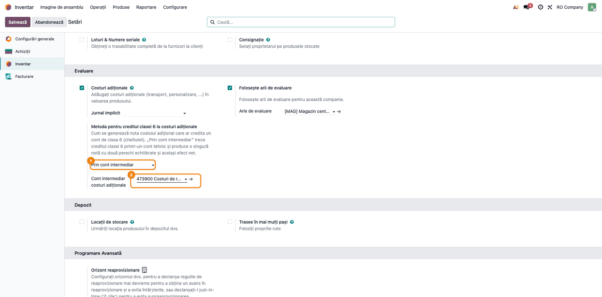
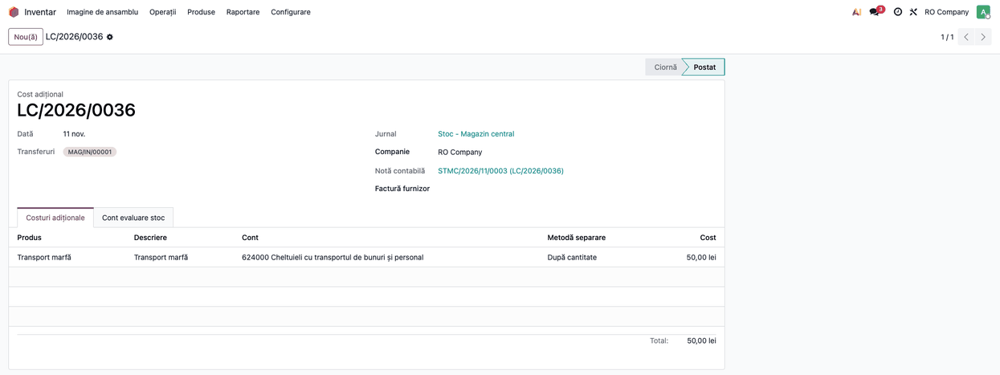
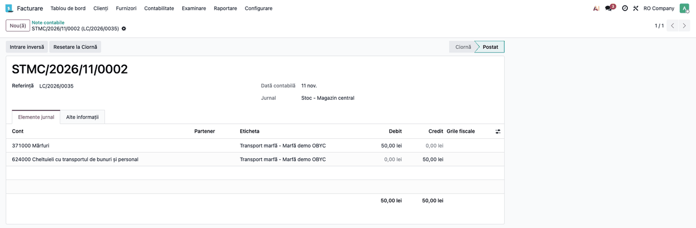
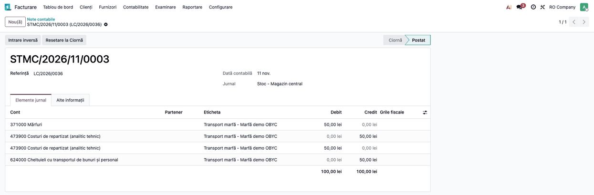
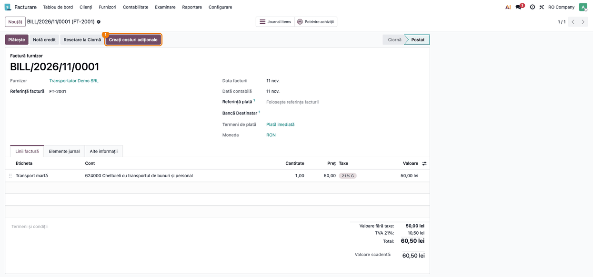

# Fișa consultant: OBYC - Rutarea clasei 6 la costuri adiționale

## 1. Scop business

Costul de achiziție adăugat ulterior unei recepții (transport, manipulare) se capitalizează în stoc:
Dr 371 Mărfuri. Cu `deltatech_obyc`, contul de stoc vine din regula OBYC **Costuri Adiționale Stoc**
(cheia `landed_cost`), nu de pe locație. Dacă linia de cost are un cont de cheltuieli (clasa 6),
nota standard este Dr 371 / Cr 6xx.

Modulul adaugă, pe companie, două lucruri:

- **rutarea clasei 6 printr-un cont intermediar tehnic**: creditul pe 6xx trece printr-un cont cu sold
  zero, într-o singură notă cu două perechi echilibrate (stoc / intermediar și intermediar / 6xx),
  pentru exporturi contabile care cer note echilibrate pe perechi de conturi;
- **completarea automată a costului adițional creat din factura de furnizor**: recepțiile comenzii
  de achiziție și contul fiecărei linii se iau din factură.

Modulul înlocuiește `l10n_ro_stock_account_landed_cost_account` la companiile care folosesc
`deltatech_obyc` în locul lui `l10n_ro_stock_account`.

## 2. Bază legală și context

- **OMFP 1802/2014**, definiția costului de achiziție: cheltuielile de transport, manipulare și alte cheltuieli
  direct atribuibile achiziției intră în costul de achiziție al stocului (verificat cu Pacioli,
  11.11.2026).
- Efectul net Dr 371 / Cr 624 și cel prin contul intermediar este identic. Contul intermediar este o
  soluție tehnică: planul de conturi nu are un cont consacrat pentru el, iar Pacioli nu recomandă 482
  (decontări între subunități). Contul nu poate fi din clasa 6 (ar apărea și pe debit, și pe credit
  în aceeași notă); exemplul folosește un analitic de 473 „Decontări din operații în curs de
  clarificare”. Firma își definește un **analitic tehnic propriu**, cu
  sold zero la fiecare operațiune, prin politica contabilă (în exemple: `473900 Costuri de
  repartizat`).
- Se capitalizează doar cantitatea rămasă în stoc; partea deja vândută rămâne pe 624. Dacă se
  reclasifică în costul vânzărilor (Dr 607 / Cr 624) este o decizie a politicii de evaluare a
  firmei: legea cere ca transportul direct atribuibil mărfii vândute să se reflecte în costul
  vânzărilor, dar nu impune o notă anume.

## 3. Utilizatori și roluri

| Rol | Ce face |
|---|---|
| Administrator contabil | Alege metoda și contul intermediar în Setări; definește regula OBYC `landed_cost` |
| Contabil | Validează costurile adiționale și verifică notele |
| Operator de stoc | Creează costul adițional din factură sau din recepție (drept de inventar) |

## 4. Conturi și date implicate

| Cont | Rol |
|---|---|
| 371 Mărfuri | Cont de evaluare din regula `landed_cost` (Dr) |
| 624 Cheltuieli cu transportul | Contul liniei de cost (Cr), înregistrat la factura transportatorului |
| 473900 Costuri de repartizat | Exemplu de analitic tehnic intermediar (clasa 4), definit de firmă; nu poate fi cont de clasa 6 |
| 609 Reduceri comerciale primite | Nu se rutează niciodată |

Date: regula OBYC `Costuri Adiționale Stoc` cu **Contul de evaluare**, produs stocabil cu clasă de
evaluare și cost mediu sau FIFO, produs de serviciu cu **Este cost adițional** bifat.

## 5. Configurare inițială

1. *Inventar → Configurare → Setări*, blocul **Evaluare**: **Metoda pentru creditul clasei 6 la costuri adiționale** =
   *Prin cont intermediar*; apare **Cont intermediar** (obligatoriu).
2. Regula OBYC **Costuri Adiționale Stoc** cu **Contul de evaluare** completat (fișa `deltatech_obyc`,
   Pasul 10).
3. Produsul de transport: contul de cheltuială al liniei de cost (624, sau 408 dacă nota trebuie să
   stingă un 408).

Metoda *Standard* (implicită) păstrează comportamentul Odoo: Dr 371 / Cr 6xx.

## 6. Flux de utilizare

### Pasul 1 — Setarea metodei și a contului intermediar

*Inventar → Configurare → Setări*, blocul **Evaluare**.

1. **Găsiți pe ecran:** **Metoda pentru creditul clasei 6 la costuri adiționale** și **Cont intermediar** (vizibil doar la
   metoda *Prin cont intermediar*).
2. **Completați:** metoda *Prin cont intermediar* și contul tehnic ales de firmă (aici 473900).
3. **Verificați:** setarea se salvează cu **Salvează**; fără cont, câmpul e obligatoriu.

### Pasul 2 — Costul adițional pe o recepție

*Inventar → Operații → Ajustări → Costuri adiționale* → document nou pe o recepție de 10 buc., linia
„Transport marfă” de 50 lei cu contul 624000, împărțire după cantitate → **Calculează** →
**Validează**.

1. **Găsiți pe ecran:** starea *Postat* și nota contabilă din câmpul **Notă contabilă**.
2. **Verificați:** nota e pe jurnalul ales în document (aici „Stoc - Magazin central”).

### Pasul 3 — Nota cu metoda standard

Același cost, cu metoda *Standard*: o singură pereche, Dr 371 / Cr 624.

1. **Găsiți pe ecran:** liniile 371000 (debit) și 624000 (credit).
2. **Verificați:** Dr 371 = Cr 624 = 50,00 lei.

### Pasul 4 — Nota prin cont intermediar

Același cost, cu metoda *Prin cont intermediar*: o notă cu patru linii.

1. **Găsiți pe ecran:** 371000 (Dr 50), 473900 (Cr 50), 473900 (Dr 50), 624000 (Cr 50).
2. **Verificați:** totalul 100,00 / 100,00 lei; contul intermediar are sold zero (Dr = Cr).

### Pasul 5 — Costul adițional creat din factura de furnizor

*Contabilitate → Furnizori → Facturi*: factura transportatorului, postată, cu linia de transport
(produs „Este cost adițional”) de 50,00 lei pe 624000. Nota facturii: Dr 624 (50,00) + Dr 4426 (10,50,
TVA 21%) / Cr 401 (60,50).

1. **Găsiți pe ecran:** butonul **Creați costuri adiționale** din antetul facturii (apare doar când
   factura are linii de cost adițional).
2. **Apăsați** butonul: se deschide documentul de costuri adiționale, completat cu **recepțiile**
   comenzilor de achiziție de pe factură (terminate, neacoperite de un alt cost adițional validat) și
   cu **contul** fiecărei linii de cost, luat din linia facturii cu același produs.
3. **Verificați:** recepțiile și contul 624000; un al doilea cost (de exemplu vama) nu găsește
   recepția, deci se adaugă manual. Apoi **Calculează** și **Validează**, ca la Pasul 2.

### Note de monografie

Exemplu: recepție de 10 buc., transport de 50 lei pe 624000.

| Metodă | Debit | Credit | Sumă |
|---|---|---|---|
| Standard | 371 | 624 | 50,00 |
| Prin cont intermediar | 371 | 473900 | 50,00 |
| | 473900 | 624 | 50,00 |

Nu se rutează: clasa 609, conturile din afara clasei 6, debitul unui cost negativ.

## 7. Legături cu alte module / declarații

- `deltatech_obyc`: regula `landed_cost` (contul de stoc), jurnalul și aria (fișa lui, Pasul 10).
- `stock_landed_costs` (standard Odoo): documentul, metodele de împărțire.
- Înlocuiește `l10n_ro_stock_account_landed_cost_account` (OCA/l10n-romania), care cere
  `l10n_ro_stock_account` și nu poate funcționa cu `deltatech_obyc`.
- Nu generează declarații; nota intră în balanță și în fișa contului 371.

## 8. Verificări pentru consultant

- Soldul contului intermediar este 0 după fiecare cost adițional.
- Valoarea recepției crește cu suma costului (1.000 → 1.050 lei în exemplu).
- Nota e pe jurnalul din document, în aria produsului.
- Costul creat din factură: recepțiile comenzilor de achiziție terminate și neacoperite sunt completate,
  iar contul fiecărei linii este cel din linia facturii cu același produs (o linie de cost fără linie
  de factură cu același produs rămâne cu contul produsului de transport).
- Partea de marfă deja vândută nu se capitalizează: rămâne pe 624 și se tratează conform politicii
  de evaluare a firmei.

## 9. Mesaje de eroare frecvente

| Situație | Cauză | Remediere |
|---|---|---|
| Nu apare nicio rutare, deși metoda e *Prin cont intermediar* | Contul intermediar lipsește (date importate sau setate pe altă companie; din Setări câmpul e obligatoriu); se aplică tăcut metoda standard | Completați contul în Setări |
| Nu se generează nicio notă | Produsul nu are evaluare în timp real sau metoda de cost nu e mediu/FIFO | Categoria produsului: evaluare în timp real, cost mediu sau FIFO |
| `Please configure Stock Expense Account` | Linia de cost fără cont și produsul de transport fără cont de cheltuială | Completați contul liniei sau al produsului |
| Costul creat din factură nu are recepții | Recepțiile au deja un cost adițional validat sau nu sunt terminate | Adăugați recepțiile manual |

## 10. Capturi de ecran

| Fișier | Ce arată |
|---|---|
| `01_settings_landed_cost.png` | Setările: metoda și contul intermediar |
| `02_landed_cost_form.png` | Costul adițional validat |
| `03_note_standard.png` | Nota Dr 371 / Cr 624 |
| `04_note_intermediary.png` | Nota prin cont intermediar |
| `05_vendor_bill_button.png` | Factura transportatorului cu butonul Creați costuri adiționale |

## 11. Observații pentru manual

- Contul intermediar nu este un cont OMFP consacrat: textul manualului trebuie să spună că îl
  definește firma prin politica contabilă și că nu se folosește 482.
- Metoda se alege pe companie și se aplică tuturor costurilor adiționale validate după activare.
- La migrarea de la `l10n_ro_stock_account_landed_cost_account`, câmpurile vechi
  `l10n_ro_landed_cost_*` nu se migrează automat: metoda și contul se reintroduc în Setări.
