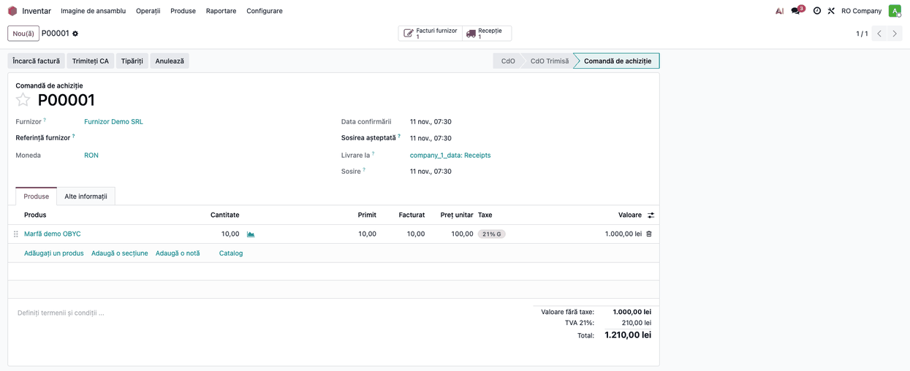
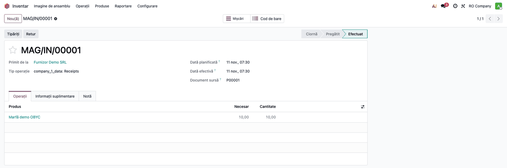
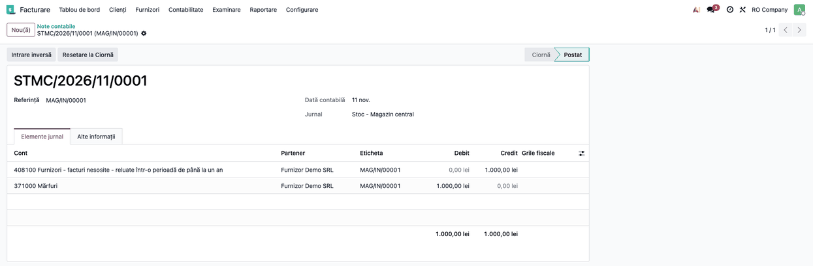
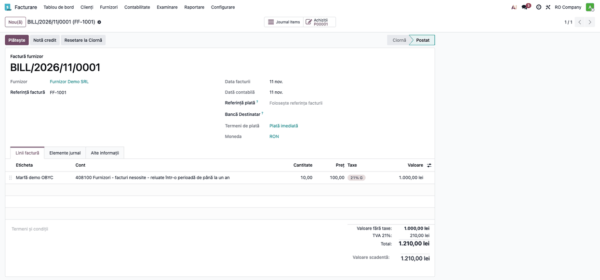
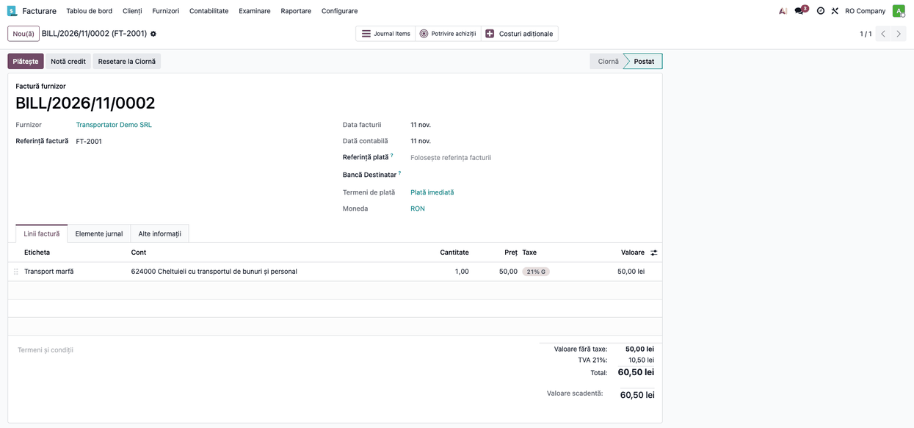
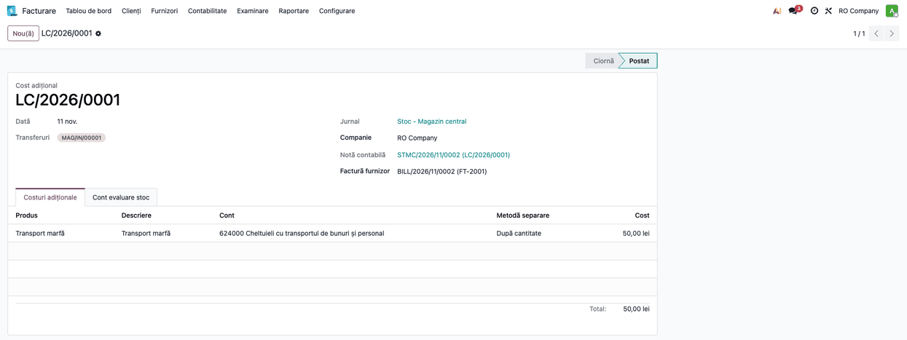
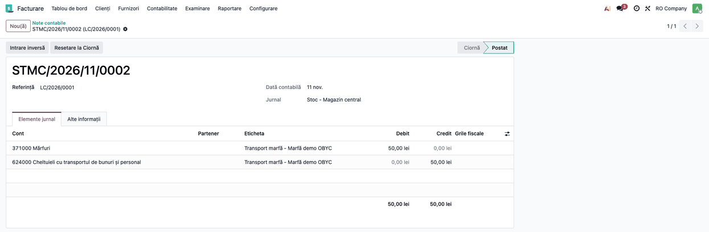
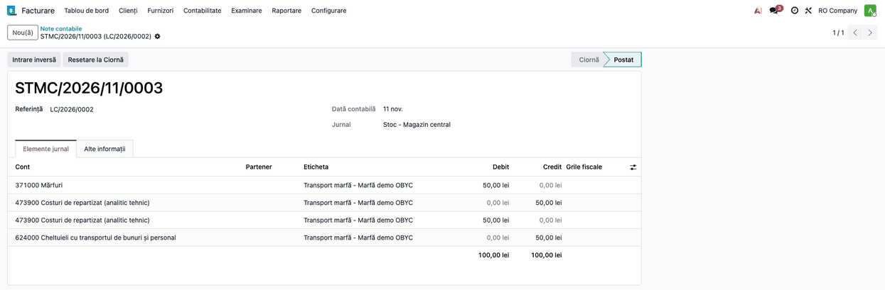

# Fișa consultant: OBYC - Rutarea clasei 6 la costuri adiționale

## 1. Scop business

Costul de achiziție adăugat ulterior unei recepții (transport, manipulare) se capitalizează în stoc:
Dr 371 Mărfuri. Cu `deltatech_obyc`, contul de stoc vine din regula OBYC **Costuri Adiționale Stoc**
(cheia `landed_cost`), nu de pe locație. Dacă linia de cost are un cont de cheltuieli (clasa 6),
nota standard este Dr 371 / Cr 6xx.

Modulul adaugă, pe companie, două lucruri:

- **rutarea clasei 6 printr-un cont intermediar tehnic**: creditul pe 6xx trece printr-un cont cu sold
  zero, într-o singură notă cu două perechi echilibrate (stoc / intermediar și intermediar / 6xx),
  pentru exporturi contabile care cer note echilibrate pe perechi de conturi;
- **completarea automată a costului adițional creat din factura de furnizor**: recepțiile comenzii
  de achiziție și contul fiecărei linii se iau din factură.

Modulul înlocuiește `l10n_ro_stock_account_landed_cost_account` la companiile care folosesc
`deltatech_obyc` în locul lui `l10n_ro_stock_account`.

## 2. Bază legală și context

- **OMFP 1802/2014**, definiția costului de achiziție: cheltuielile de transport, manipulare și alte cheltuieli
  direct atribuibile achiziției intră în costul de achiziție al stocului (verificat cu Pacioli,
  11.11.2026).
- Efectul net Dr 371 / Cr 624 și cel prin contul intermediar este identic. Contul intermediar este o
  soluție tehnică: planul de conturi nu are un cont consacrat pentru el, iar Pacioli nu recomandă 482
  (decontări între subunități). Contul nu poate fi din clasa 6 (ar apărea și pe debit, și pe credit
  în aceeași notă); exemplul folosește un analitic de 473 „Decontări din operații în curs de
  clarificare”. Firma își definește un **analitic tehnic propriu**, cu
  sold zero la fiecare operațiune, prin politica contabilă (în exemple: `473900 Costuri de
  repartizat`).
- Se capitalizează doar cantitatea rămasă în stoc; partea deja vândută rămâne pe 624. Dacă se
  reclasifică în costul vânzărilor (Dr 607 / Cr 624) este o decizie a politicii de evaluare a
  firmei: legea cere ca transportul direct atribuibil mărfii vândute să se reflecte în costul
  vânzărilor, dar nu impune o notă anume.

## 3. Utilizatori și roluri

| Rol | Ce face |
|---|---|
| Administrator contabil | Alege metoda și contul intermediar în Setări; definește regula OBYC `landed_cost` |
| Contabil | Validează costurile adiționale și verifică notele |
| Operator de stoc | Creează costul adițional din factură sau din recepție (drept de inventar) |

## 4. Conturi și date implicate

| Cont | Rol |
|---|---|
| 371 Mărfuri | Cont de evaluare din regula `landed_cost` (Dr) |
| 624 Cheltuieli cu transportul | Contul liniei de cost (Cr), înregistrat la factura transportatorului |
| 473900 Costuri de repartizat | Exemplu de analitic tehnic intermediar (clasa 4), definit de firmă; nu poate fi cont de clasa 6 |
| 609 Reduceri comerciale primite | Nu se rutează niciodată |

Date: regula OBYC `Costuri Adiționale Stoc` cu **Contul de evaluare**, produs stocabil cu clasă de
evaluare și cost mediu sau FIFO, produs de serviciu cu **Este cost adițional** bifat.

## 5. Configurare inițială

1. **Setarea metodei și a contului intermediar.** *Inventar → Configurare → Setări*, blocul
   **Evaluare**:
   - **Metoda pentru creditul clasei 6 la costuri adiționale**: *Standard* (implicit, Dr 371 / Cr 6xx)
     sau *Prin cont intermediar*;
   - **Cont intermediar**: apare la metoda *Prin cont intermediar* și este obligatoriu. Este un cont
     tehnic ales de firmă (aici 473900), cu sold zero la fiecare operațiune; nu poate fi din clasa 6.
   - Salvați cu **Salvează**.

2. **Regula OBYC** **Costuri Adiționale Stoc** (`landed_cost`) cu **Contul de evaluare** completat
   (fișa `deltatech_obyc`, Pasul 10), alături de regula de recepție.
3. **Produsul de transport**: serviciu cu **Este cost adițional** bifat, cu contul de cheltuială 624.
4. **Produsul de marfă**: stocabil, clasă de evaluare, categorie cu evaluare în timp real și cost
   mediu sau FIFO.

## 6. Flux de utilizare

Fluxul complet: comanda de achiziție → recepția → factura furnizorului de marfă → factura
transportatorului → costul adițional → nota costului adițional.

### Pasul 1 — Comanda de achiziție

*Achiziții → Comenzi → Cereri de ofertă*: comandă nouă către furnizorul de marfă, 10 buc. × 100 lei,
**Confirmă comanda**.

1. **Găsiți pe ecran:** starea *Comandă de achiziție* și butoanele **Recepție** și **Facturi furnizor**.
2. **Verificați:** se creează recepția comenzii.

### Pasul 2 — Recepția mărfii

Din comandă, butonul **Recepție** → **Validează**. Odoo generează nota de stoc din regula OBYC de
recepție.

1. **Găsiți pe ecran:** starea *Efectuat* a transferului.
2. **Verificați:** nota are Dr 371 / Cr 408, câte 1.000,00 lei (cheia *Recepție stoc de la furnizor*).

### Pasul 3 — Factura furnizorului de marfă

Din comandă, **Creează factură** (sau *Facturi furnizor*) → **Confirmă**.

1. **Găsiți pe ecran:** linia de produs pe contul 408 (contul sursă al regulii de recepție).
2. **Verificați:** nota facturii stinge 408: Dr 408 (1.000,00) + Dr 4426 (210,00) / Cr 401 (1.210,00).

### Pasul 4 — Factura transportatorului

*Contabilitate → Furnizori → Facturi*: factura transportatorului, cu linia „Transport marfă” de
50,00 lei pe contul 624 (produs cu **Este cost adițional**), apoi **Confirmă**. Nota facturii:
Dr 624 (50,00) + Dr 4426 (10,50, TVA 21%) / Cr 401 (60,50).

1. **Găsiți pe ecran:** butonul **Creați costuri adiționale**, vizibil doar pe facturile cu linii de
   cost adițional.
2. **Verificați:** factura este *Postată*, iar linia de transport e pe 624000.

### Pasul 5 — Costul adițional

Apăsați **Creați costuri adiționale** pe factura transportatorului. Se deschide documentul, cu linia
de cost (contul luat din linia facturii) și factura de furnizor completată.

1. **Completați:** în câmpul **Transferuri**, recepția mărfii (se completează automat doar dacă
   factura are o comandă de achiziție cu recepții terminate și neacoperite de alt cost adițional
   validat; altfel o adăugați manual) și **Jurnal**.
2. **Apăsați** **Calculează**, apoi **Validează**.
3. **Verificați:** starea *Postat* și nota din câmpul **Notă contabilă**, pe jurnalul ales.

### Pasul 6 — Nota costului adițional

Cu metoda **Standard**: o singură pereche, Dr 371 / Cr 624.

1. **Găsiți pe ecran:** liniile 371000 (debit) și 624000 (credit).
2. **Verificați:** Dr 371 = Cr 624 = 50,00 lei.

Cu metoda **Prin cont intermediar** (același flux, a doua factură de transport): o notă cu patru linii.

1. **Găsiți pe ecran:** 371000 (Dr 50), 473900 (Cr 50), 473900 (Dr 50), 624000 (Cr 50).
2. **Verificați:** totalul 100,00 / 100,00 lei; contul intermediar are sold zero (Dr = Cr).

### Note de monografie

Fluxul complet din exemplu:

| Operațiune | Debit | Credit | Sumă |
|---|---|---|---|
| Recepție 10 buc. | 371 | 408 | 1.000,00 |
| Factura de marfă | 408 / 4426 | 401 | 1.000,00 + 210,00 |
| Factura de transport | 624 / 4426 | 401 | 50,00 + 10,50 |
| Cost adițional, metoda Standard | 371 | 624 | 50,00 |
| Cost adițional, prin cont intermediar | 371 | 473900 | 50,00 |
| | 473900 | 624 | 50,00 |

Nu se rutează: clasa 609, conturile din afara clasei 6, debitul unui cost negativ.

## 7. Legături cu alte module / declarații

- `deltatech_obyc`: regula `landed_cost` (contul de stoc), jurnalul și aria (fișa lui, Pasul 10).
- `stock_landed_costs` (standard Odoo): documentul, metodele de împărțire.
- Înlocuiește `l10n_ro_stock_account_landed_cost_account` (OCA/l10n-romania), care cere
  `l10n_ro_stock_account` și nu poate funcționa cu `deltatech_obyc`.
- Nu generează declarații; nota intră în balanță și în fișa contului 371.

## 8. Verificări pentru consultant

- Soldul contului intermediar este 0 după fiecare cost adițional.
- Valoarea recepției crește cu suma costului (1.000 → 1.050 lei în exemplu).
- Nota e pe jurnalul din document, în aria produsului.
- Costul creat din factură: recepțiile comenzilor de achiziție terminate și neacoperite sunt completate,
  iar contul fiecărei linii este cel din linia facturii cu același produs (o linie de cost fără linie
  de factură cu același produs rămâne cu contul produsului de transport).
- Partea de marfă deja vândută nu se capitalizează: rămâne pe 624 și se tratează conform politicii
  de evaluare a firmei.

## 9. Mesaje de eroare frecvente

| Situație | Cauză | Remediere |
|---|---|---|
| Nu apare nicio rutare, deși metoda e *Prin cont intermediar* | Contul intermediar lipsește (date importate sau setate pe altă companie; din Setări câmpul e obligatoriu); se aplică tăcut metoda standard | Completați contul în Setări |
| `The landed cost intermediary account must not be a class 6 (expense) account` | S-a ales ca intermediar un cont din clasa 6 (ar apărea și pe debit, și pe credit) | Alegeți un cont tehnic din altă clasă (analitic de 473) |
| Nu se generează nicio notă | Produsul nu are evaluare în timp real sau metoda de cost nu e mediu/FIFO | Categoria produsului: evaluare în timp real, cost mediu sau FIFO |
| `Please configure Stock Expense Account` | Linia de cost fără cont și produsul de transport fără cont de cheltuială | Completați contul liniei sau al produsului |
| Costul creat din factură nu are recepții | Recepțiile au deja un cost adițional validat sau nu sunt terminate | Adăugați recepțiile manual |

## 10. Capturi de ecran

| Fișier | Ce arată |
|---|---|
| `01_settings_landed_cost.png` | Setările: metoda și contul intermediar |
| `02_purchase_order.png` | Comanda de achiziție confirmată |
| `03_receipt.png` | Recepția validată |
| `04_receipt_note.png` | Nota recepției (Dr 371 / Cr 408) |
| `05_goods_bill.png` | Factura furnizorului de marfă |
| `06_transport_bill_button.png` | Factura transportatorului cu butonul Creați costuri adiționale |
| `07_landed_cost_form.png` | Costul adițional validat |
| `08_note_standard.png` | Nota Dr 371 / Cr 624 |
| `09_note_intermediary.png` | Nota prin cont intermediar |

## 11. Observații pentru manual

- Contul intermediar nu este un cont OMFP consacrat: textul manualului trebuie să spună că îl
  definește firma prin politica contabilă și că nu se folosește 482.
- Metoda se alege pe companie și se aplică tuturor costurilor adiționale validate după activare.
- La migrarea de la `l10n_ro_stock_account_landed_cost_account`, câmpurile vechi
  `l10n_ro_landed_cost_*` nu se migrează automat: metoda și contul se reintroduc în Setări.
