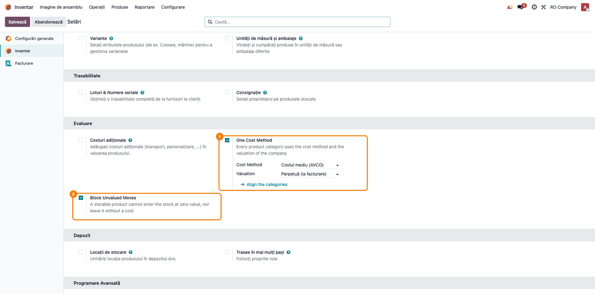
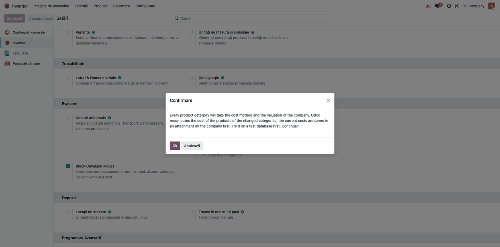
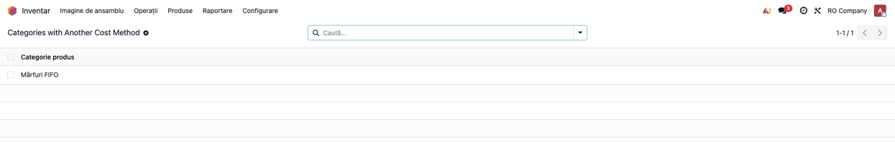
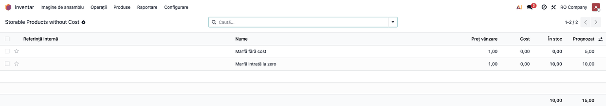
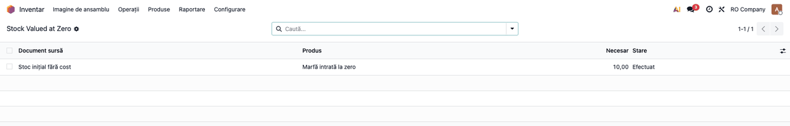
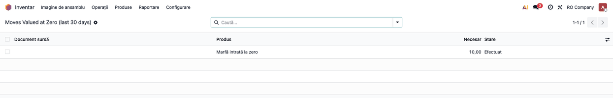

# Fișă Modul: Controlul evaluării stocului — metodă unică de cost și fără mișcări nevalorizate

**Modul:** `deltatech_stock_valuation_guard`
**Utilizator principal:** contabil stocuri / contabil-șef, administrator Odoo
**Prioritate:** 🟡 Medie (protecție: nu produce note contabile, dar împiedică erorile care strică
valoarea stocului și costul vânzărilor)

> Interfața proprie a modulului (bifele din Setări, meniul *Valuation Control*, mesajele de eroare)
> nu are încă traducere în română: în capturi și în textul de mai jos etichetele modulului apar în
> engleză, iar cele din Odoo standard în română.

---

## 1. Scop business

Modulul adaugă două controale, pornite separat pe fiecare companie, care țin evaluarea stocului
credibilă pentru contabilitate:

- **o singură metodă de cost** pentru toate categoriile de produse ale companiei. În Odoo metoda de
  cost (Preț standard, FIFO, Cost mediu) și evaluarea (periodică sau perpetuă) se setează pe fiecare
  categorie, iar în timp o bază ajunge cu categorii pe metode diferite, pe care contabilitatea
  trebuie să le explice la fiecare închidere. Modulul refuză categoriile pe altă metodă și le poate
  alinia pe toate dintr-un singur buton, după ce salvează costurile curente;
- **nicio mișcare de stoc fără valoare**: o recepție la preț zero, un plus la inventar sau o
  corecție de cantitate pe un produs fără cost, ori un retur la valoare zero, aduc în stoc marfă
  valorizată la zero; vânzările următoare o scot tot la zero, iar costul mărfurilor vândute iese
  subevaluat. Cu blocarea pornită, astfel de mișcări nu mai pot fi validate.

Pe lângă blocări, modulul oferă patru **liste de control** (meniul *Valuation Control*) cu situațiile
de corectat: categorii pe altă metodă, produse stocabile fără cost, stoc valorizat la zero și
mișcări valorizate la zero în ultimele 30 de zile.

## 2. Bază legală și context

Referințe din **OMFP 1802/2014**:

- **pct. 287 alin. (2)**: pentru stocurile de aceeași natură și utilizare similară se folosesc
  aceleași metode de determinare a costului; **alin. (3)**: pentru stocuri de natură sau utilizare
  diferită pot fi justificate metode diferite; **alin. (4)**: localizarea geografică diferită nu
  justifică, singură, metode diferite;
- **pct. 287 alin. (1)**: metoda aleasă se aplică consecvent de la un exercițiu la altul; numai în
  situații excepționale administratorii pot decide schimbarea ei, iar în notele explicative se
  prezintă motivul și efectele asupra rezultatului;
- **pct. 96 alin. (1)**: metodele de determinare a costului la ieșire (CMP, FIFO, LIFO);
- **pct. 286 alin. (1) și (3)**: costul standard (în producție) și prețul cu amănuntul (în comerțul cu
  amănuntul) sunt permise, cu diferențele de preț în conturile 308 / 348 / 378;
- **pct. 60 alin. (2)**: alegerea metodei de evaluare a stocurilor este o politică contabilă;
  **pct. 63**: efectul schimbării ei asupra exercițiilor precedente se înregistrează pe 1173
  „Rezultatul reportat provenit din modificările politicilor contabile” (alin. 1), iar cel asupra
  exercițiului curent pe cheltuieli sau venituri (alin. 2); **pct. 64 alin. (2)**: schimbarea se
  prezintă în notele explicative;
- **pct. 75 alin. (1) lit. d)**: bunurile obținute cu titlu gratuit și plusurile la inventar se
  evaluează la **valoarea justă**;
- **pct. 76 alin. (1^1)**: bunurile cu reduceri comerciale înscrise pe factură care acoperă integral
  contravaloarea se înregistrează la **valoarea justă**, pe seama contului 758 — nu la zero.

Ce face modulul față de aceste reguli:

- bifa **One Cost Method** impune o singură metodă pe companie. Dacă firma are stocuri de natură
  diferită care justifică metode diferite (alin. 3), bifa nu trebuie pornită;
- butonul **Align the categories** este o **schimbare a metodei de evaluare**, deci a politicii
  contabile: o aprobă administratorii entității (pct. 61, 287 alin. 1), iar contabilul-șef o execută
  în Odoo, la o dată aleasă (de regulă începutul exercițiului), și se prezintă în notele
  explicative (alin. 1). Modulul nu generează nota contabilă a efectului — vezi pasul 2;
- blocarea **Block Unvalued Moves** este o regulă internă de control, nu o cerință expresă a
  legii: o intrare fără valoare indică de regulă un cost lipsă (o eroare), dar există și intrări
  legitime fără plată, care se înregistrează la valoarea justă (pct. 75 alin. 1 lit. d, pct. 76
  alin. 1^1) — vezi
  „Note de monografie” pentru cum se tratează în Odoo.

## 3. Utilizatori și roluri

| Rol | Ce face | Drepturi necesare |
|---|---|---|
| Contabil-șef (cu drept de administrare în Odoo) | pornește bifele și execută alinierea aprobată de administratorii entității | Administrare / Setări |
| Contabil stocuri | lucrează listele de control, completează costul produselor | Inventar / Administrator (meniul *Valuation Control* e vizibil doar acestui grup) |
| Operator depozit | validează recepții, livrări, ajustări de inventar; primește mesajul de blocare | Inventar / Utilizator |

Pentru testare: un utilizator cu **Administrare / Setări** și **Inventar / Administrator** acoperă
tot fluxul; un al doilea utilizator, doar **Inventar / Utilizator**, verifică mesajul primit de
operator la validare.

## 4. Conturi și date implicate

Modulul **nu creează note contabile** și nu schimbă conturile. Efectul lui se vede în valoarea pe
care Odoo o dă mișcărilor de stoc și, prin ea, în notele de stoc create de Odoo standard:

| Cont | Rol |
|---|---|
| 371 Mărfuri | contul de stoc al categoriei: o intrare la zero nu îl debitează, o ieșire la cost zero nu îl creditează |
| 607 Cheltuieli privind mărfurile | costul mărfurilor vândute: iese subevaluat la vânzarea stocului intrat la zero |
| 401 Furnizori | contrapartida facturii de achiziție (în Odoo 19, cu evaluare perpetuă, recepția nu postează nota Dr 371 / Cr 408 a recepției fără factură) |
| 758 Alte venituri din exploatare | bunurile primite cu reducere comercială integrală, la valoarea justă (pct. 76 alin. 1^1); donațiile de stocuri pe 7582 |
| 1173 Rezultatul reportat provenit din modificările politicilor contabile | efectul alinierii asupra exercițiilor precedente (pct. 63 alin. 1) |
| 607 (rezervă la închiderea stocului) | contul pe care închiderea stocului din Odoo trece diferența dintre valoarea stocului și soldul 371: 371 nu are cont de variație în `l10n_ro`, deci se folosește contul de cheltuieli 607 |

Datele minime pentru demo (sunt și cele din capturi):

- compania **RO Company**, plan de conturi RO, monedă RON, metoda **Costul mediu (AVCO)** și
  evaluarea **Perpetuă (la facturare)** pe companie;
- categoria **Mărfuri** (aliniată) și categoria **Mărfuri FIFO** (pe altă metodă);
- produsele stocabile **Marfă fără cost** (cost 0), **Marfă cu cost** (cost 25) și **Marfă intrată
  la zero**, recepționată cu 10 buc. la valoare zero și livrată 2 buc. la cost zero, ambele
  **înainte** de pornirea blocării (8 buc. rămân în stoc la valoare zero);
- o recepție de la **Furnizor Demo SRL** pentru 5 buc. din **Marfă fără cost**, gata de validare.

## 5. Configurare inițială

1. Pe fiecare categorie de mărfuri (**Inventar → Configurare → Categorii de produse**), contul de
   evaluare a stocului = **371 Mărfuri**: planul `l10n_ro` pune implicit **301**.
2. **Inventar → Configurare → Setări**, secțiunea **Evaluare**: bifați **One Cost Method**,
   verificați **Cost Method** și **Valuation** ale companiei și **Salvați** (pasul 1).
3. Pe o **bază de test**, apăsați **Align the categories** și verificați costurile și valoarea
   stocului; abia apoi repetați pe baza de producție (pasul 2). Alinierea **recalculează costul**
   produselor din categoriile schimbate, deci completarea costurilor vine după ea.
4. **Inventar → Raportare → Valuation Control → Storable Products without Cost**: completați costul
   produselor stocabile pe care încă le vindeți (pasul 3).
5. Abia apoi bifați **Block Unvalued Moves** și **Salvați**; altfel livrările produselor fără cost
   nu mai pot fi validate.

## 6. Flux de utilizare

### Pasul 1 — Pornirea controalelor pe companie

**Inventar → Configurare → Setări**, secțiunea **Evaluare**. Modulul adaugă două bife:

- **One Cost Method** — sub ea apar **Cost Method** și **Valuation**, metoda de cost și evaluarea
  companiei, aduse aici din Odoo standard, plus butonul **Align the categories**. Cu bifa pornită,
  crearea sau modificarea unei categorii de produse pe altă metodă sau altă evaluare decât ale
  companiei este refuzată;
- **Block Unvalued Moves** — refuză validarea mișcărilor de stoc care ar rămâne fără valoare.

**Atenție la ordine:** bifați **Block Unvalued Moves** abia după ce ați completat costurile
lipsă (pasul 3); altfel livrările produselor fără cost nu mai pot fi validate. Captura arată
setările finale, cu ambele bife.

Apăsați **Salvează**. Setările sunt per companie: celelalte companii din bază nu sunt afectate.



### Pasul 2 — Alinierea categoriilor pe metoda companiei

Tot în **Setări**, sub **One Cost Method**, apăsați **Align the categories**. Odoo cere confirmarea:
toate categoriile de produse primesc metoda de cost și evaluarea companiei.



După **Ok**:

- înainte de schimbare, costurile curente ale produselor din categoriile modificate și metoda veche
  a fiecărei categorii se salvează într-un **atașament JSON pe companie**
  (`valuation_guard_snapshot_<data>.json`), pentru o eventuală refacere punctuală a unui cost;
- categoriile trec pe metoda companiei, iar Odoo **recalculează costul** produselor lor după noua
  metodă, din istoricul mișcărilor (la *Preț standard* costul rămâne cel existent);
- un mesaj confirmă câte categorii au fost aliniate, câte costuri au fost salvate și numele
  atașamentului.

Alinierea **nu creează notă contabilă**. După aliniere, contabilul compară valoarea stocului din **Inventar → Raportare →
Stoc** (coloana **Valoare totală**; în Enterprise și raportul de evaluare a stocului din
Contabilitate) cu soldul contului 371 din balanță și decide înregistrarea diferenței
(vezi „Note de monografie"). Nota manuală se face **înaintea primei închideri de stoc** din Odoo:
altfel închiderea trece diferența pe contul de variație al contului de stoc (607 la 371 în `l10n_ro`).

Dacă toate categoriile sunt deja aliniate, butonul răspunde cu mesajul *Every product category
already uses the cost method of the company* și nu schimbă nimic.

### Pasul 3 — Liste de control: categorii pe altă metodă și produse fără cost

**Inventar → Raportare → Valuation Control** (vizibil pentru *Inventar / Administrator*):

**Categories with Another Cost Method** — categoriile a căror metodă de cost sau evaluare diferă de
ale companiei.

1. **Găsiți pe ecran**: fiecare rând e o categorie de produse, cu numele complet (inclusiv
   categoria părinte, dacă are). Lista nu arată metoda; deschideți categoria ca s-o vedeți.
2. **Verificați**: după alinierea din pasul 2 lista trebuie să fie **goală**. O categorie rămasă
   aici înseamnă fie că alinierea nu s-a făcut, fie că bifa *One Cost Method* e oprită și cineva a
   modificat categoria.
3. **Treceți mai departe**: deschideți categoria și puneți metoda companiei, sau rulați din nou
   alinierea.



**Storable Products without Cost** — produsele stocabile cu cost zero sau negativ.

1. **Găsiți pe ecran**: fiecare rând e o variantă de produs stocabil; costul ei este 0.
2. **Verificați**: produsele pe care le vindeți sau le recepționați fără comandă de achiziție nu
   trebuie să apară aici. Produsele care nu se mai folosesc pot rămâne (sau se arhivează).
3. **Treceți mai departe**: deschideți produsul și completați **Cost**, înainte de pornirea blocării.



### Pasul 4 — Validare refuzată pentru o mișcare fără valoare

Cu **Block Unvalued Moves** pornit, validarea unei recepții, a unei livrări sau a unei ajustări de
inventar care ar rămâne fără valoare se oprește cu lista produselor de corectat. Exemplu: recepția
de 5 buc. **Marfă fără cost**, fără comandă de achiziție, apăsând **Validează**.


Ce se verifică, doar pentru produsele **stocabile**:

| Mișcare | Refuzată când |
|---|---|
| intrare (recepție, plus la inventar, corecție de cantitate, retur) | valoarea pe care ar primi-o la validare este zero — din factură, din comanda de achiziție, din retur sau din costul produsului |
| ieșire (livrare, minus la inventar, consum) | produsul nu are cost |

Remediere: completați **Cost** pe produs sau prețul pe linia comenzii de achiziție, apoi validați din
nou. Mișcările deja validate sau anulate nu se verifică; nici cele ale produselor consumabile sau
servicii.

Comenzile din **Punct de vânzare** nu se blochează aici: mișcările lor se validează pe server după
emiterea bonului fiscal. De ele se ocupă modulul *Stock Valuation Guard - Point of Sale*, care
oprește produsul fără cost direct în coș.

### Pasul 5 — Stocul valorizat la zero

**Inventar → Raportare → Valuation Control → Stock Valued at Zero**: intrările validate la valoare
zero (produse stocabile, compania curentă) din care **mai există cantitate în stoc** — stoc pe care
vânzările următoare îl vor scoate la cost zero.

1. **Găsiți pe ecran**: fiecare rând e o mișcare de intrare, cu **Document sursă**, **Produs**,
   cantitatea intrată (**Necesar** — cantitatea mișcării, nu cea rămasă în stoc) și **Stare**
   *Efectuat*. Cantitatea rămasă se vede pe fișa produsului (**În stoc**).
2. **Verificați**: fiecare rând este o intrare de dinainte de pornirea blocării (sau validată de un
   proces exceptat). Pentru fiecare, contabilul decide costul corect și nota de reevaluare.
3. **Treceți mai departe**: reevaluarea este o **decizie contabilă** (ce cost, ce notă); modulul doar
   arată ce privește. Completați întâi **Cost** pe produs, ca ieșirile următoare să nu mai fie la
   zero, apoi ajustați valoarea stocului existent din **Inventar → Raportare → Stoc**, coloana
   **Valoare totală**. Ajustarea **nu postează notă**: la închiderea stocului, diferența trece pe
   607 (Dr 371 / Cr 607). Dacă tratamentul corect e altul — 1174 pentru o eroare din exercițiul
   precedent, 758 / 7582 pentru un bun primit gratuit — faceți nota manuală **înaintea închiderii**.
   Rândul iese din listă când mișcarea de intrare are valoare sau când cantitatea ei a ieșit
   integral din stoc.



### Pasul 6 — Mișcările valorizate la zero în ultimele 30 de zile

**Inventar → Raportare → Valuation Control → Moves Valued at Zero**: intrările și ieșirile produselor
stocabile validate cu valoare zero în ultimele 30 de zile.

1. **Găsiți pe ecran**: **Document sursă**, **Produs**, cantitatea (**Necesar**) și **Stare** ale
   fiecărei mișcări valorizate la zero — intrări și ieșiri. Lista nu are coloana de dată: filtrul pe
   ultimele 30 de zile e aplicat de meniu.
2. **Verificați**: după pornirea blocării, lista nu trebuie să mai primească mișcări noi validate de
   utilizatori; dacă apar, sunt fie de dinainte, fie din procese exceptate (comenzile POS).
3. **Treceți mai departe**: folosiți lista lunar, înainte de închiderea stocului, ca să urmăriți
   efectul controalelor.



### Note de monografie și raportare

Modulul **nu generează note contabile**; notele de stoc le creează Odoo standard, la facturare
(evaluare perpetuă) sau la închidere (evaluare periodică). Modulul garantează doar că valoarea
mișcărilor care le alimentează nu e zero.

În Odoo 19, cu evaluarea **Perpetuă (la facturare)**, recepția de la furnizor nu postează nimic:
nota **Dr 371 / Cr 401** o face **factura furnizorului**, la prețul facturii. Livrarea nu postează
nici ea; costul mărfurilor vândute (**Dr 607 / Cr 371**) apare pe factura clientului, la valoarea
mișcării de ieșire. Ce previne blocarea:

| Situație fără blocare | Ce se întâmplă în contabilitate | Problema |
|---|---|---|
| intrare fără factură și fără cost (plus la inventar, bun primit fără document, recepție încă nefacturată) | nicio notă: valoarea mișcării e 0 | stocul fizic există, 371 nu crește |
| vânzarea ulterioară a acestui stoc | factura clientului nu are linia Dr 607 / Cr 371 (Odoo o omite la valoare zero) | costul mărfurilor vândute e subevaluat, profitul supraevaluat |
| recepție vândută înainte de sosirea facturii de achiziție, pe un produs fără cost | livrarea iese la cost 0; factura furnizorului debitează apoi 371 cu valoarea întreagă | 371 rămâne cu sold pentru un stoc care a ieșit deja, până la închiderea stocului, care trece diferența pe 607 |

Cu blocare, intrarea fără preț nu se mai validează până nu are cost, iar ieșirile au costul
produsului; notele 371 / 607 de mai sus primesc valori.

**Bunuri cu reducere comercială integrală** (pct. 76 alin. 1^1): nota **Dr 371 / Cr 758** la valoarea
justă e **manuală**, făcută de contabil; Odoo nu o generează din factura cu valoare zero. O recepție
pe o comandă de achiziție cu preț 0 rămâne **blocată** chiar dacă produsul are cost, pentru că Odoo ia
valoarea din comandă. Calea: administratorul oprește temporar bifa **Block Unvalued Moves** pe durata validării, iar
contabilul face nota manuală Dr 371 / Cr 758 **și** pune valoarea justă pe mișcarea de intrare
(**Inventar → Raportare → Stoc**, **Valoare totală**) **înaintea închiderii stocului**; fără valoarea
pe mișcare, închiderea anulează nota prin Dr 607 / Cr 371. Valoarea justă pusă doar pe linia comenzii
nu ajunge: factura cu reducere integrală readuce valoarea mișcării la zero. Donațiile de stocuri se
înregistrează pe 7582 (pct. 75 alin. 1 lit. d).

**Alinierea categoriilor** (pasul 2) schimbă costul produselor recalculat de Odoo, deci și valoarea
stocului; modulul nu înregistrează diferența. Contabilul o înregistrează manual:

- efectul asupra exercițiilor precedente: **Dr/Cr 371 = 1173** (pct. 63 alin. 1);
- efectul asupra exercițiului curent: pe seama contului de profit și pierdere (pct. 63 alin. 2);
- efectele fiscale ale ajustării pe 1173 se iau în calcul (pct. 63 alin. 4);
- prezentarea în notele explicative (pct. 64 alin. 2, pct. 287 alin. 1).

Nota se face **înaintea primei închideri de stoc** din Odoo după aliniere: închiderea postează
automat diferența dintre valoarea stocului și soldul contului de stoc pe contul de variație — la 371
în `l10n_ro`, contul de cheltuieli 607 — nu pe 1173.

## 7. Legături cu alte module / declarații

| Modul | Rol |
|---|---|
| `stock_account` (Odoo standard) | metoda de cost și evaluarea pe companie și pe categorie, valoarea mișcărilor, notele de stoc |
| `deltatech_stock_valuation_guard_pos` | se instalează automat cu *Point of Sale*: oprește în coș produsul fără cost; comenzile POS nu se mai verifică pe server |
| `deltatech_stock_valuation` | costul mediu pe produs, arie și cont al suitei; la ieșiri, controlul de aici verifică **costul global** al produsului, nu prețul pe arie: un produs cu cost global 0 și preț pe arie este blocat |

**Ce e automat:** refuzul categoriilor pe altă metodă (cu bifa pornită), refuzul validării
mișcărilor fără valoare, salvarea costurilor înainte de aliniere, listele de control.

**Ce rămâne manual:** decizia de a schimba metoda (și momentul), completarea costurilor lipsă,
reevaluarea stocului valorizat la zero, înregistrarea efectului alinierii și prezentarea lui în
notele explicative.

## 8. Verificări pentru consultant

- [ ] Cu **One Cost Method** pornit, crearea unei categorii pe *FIFO* într-o companie pe *Costul
      mediu* e refuzată cu mesajul care numește compania, metoda ei și categoria.
- [ ] **Align the categories** cere confirmare, creează atașamentul
      `valuation_guard_snapshot_<data>.json` pe companie, iar lista *Categories with Another Cost
      Method* devine goală.
- [ ] Un al doilea apel la **Align the categories** răspunde că toate categoriile sunt deja aliniate.
- [ ] Atașamentul conține, pentru fiecare categorie schimbată, metoda și evaluarea veche, și costul
      vechi al fiecărui produs.
- [ ] După aliniere, valoarea din **Inventar → Raportare → Stoc** (Valoare totală) a fost comparată cu
      soldul contului 371, iar nota manuală (1173 / profit și pierdere) e înregistrată înaintea
      primei închideri de stoc.
- [ ] Categoriile de mărfuri au contul de evaluare a stocului 371 (nu 301, implicitul `l10n_ro`).
- [ ] Cu **Block Unvalued Moves** pornit: recepția fără preț a unui produs fără cost e refuzată;
      aceeași recepție cu preț pe comanda de achiziție trece (cu Achiziții instalat).
- [ ] Livrarea unui produs stocabil fără cost e refuzată; după completarea costului, trece.
- [ ] Un plus la inventar pe un produs fără cost e refuzat.
- [ ] Produsele consumabile și serviciile nu sunt blocate.
- [ ] *Stock Valued at Zero* arată doar intrările la zero care mai au cantitate în stoc.
- [ ] *Moves Valued at Zero* arată doar mișcările din ultimele 30 de zile ale companiei curente.
- [ ] Meniul *Valuation Control* nu apare unui utilizator doar cu *Inventar / Utilizator*.

## 9. Mesaje de eroare frecvente

| Mesaj | Cauză | Remediere |
|---|---|---|
| *The company … uses one cost method for every product category: …. These categories differ: …* | se creează sau se modifică o categorie pe altă metodă sau evaluare, cu **One Cost Method** pornit | lăsați metoda companiei pe categorie; dacă metoda companiei trebuie schimbată, schimbați-o în Setări și rulați alinierea |
| *These stock moves would carry no value: - … enters the stock with no value* | intrare (recepție, plus la inventar, retur) fără preț și pe un produs fără cost | completați **Cost** pe produs sau prețul pe comanda de achiziție, apoi validați din nou |
| *These stock moves would carry no value: - … has no cost* | ieșire (livrare, minus la inventar) pentru un produs fără cost | completați **Cost** pe produs |
| *Every product category already uses the cost method of the company.* | **Align the categories** apăsat când nu e nimic de aliniat | nimic de făcut |

## 10. Capturi de ecran

Capturile sunt **generate automat** din `tests/test_screenshots.py` (mixinul `ScreenshotCase` din
`deltatech_doc_screenshots`, import defensiv), în RO, pe planul de conturi RO, în
`static/description/`; aceleași shot-uri, în engleză, ajung în `static/description/en/` pentru
`readme/USAGE.md`.

| Fișier | Pas | Conținut |
|---|---|---|
| `01_setari_valuation_guard.png` | 1 | Setări Inventar, secțiunea Evaluare, cu cele două bife |
| `02_confirmare_aliniere.png` | 2 | confirmarea butonului **Align the categories** |
| `03_categorii_alta_metoda.png` | 3 | lista *Categories with Another Cost Method* |
| `04_produse_fara_cost.png` | 3 | lista *Storable Products without Cost* |
| `05_receptie_refuzata.png` | 4 | recepția refuzată la validare, cu mesajul de eroare |
| `06_stoc_valorizat_zero.png` | 5 | lista *Stock Valued at Zero* |
| `07_miscari_valorizate_zero.png` | 6 | lista *Moves Valued at Zero* |

Regenerare:

```bash
./odoo/odoo-bin -c odoo.conf -d test20 -i l10n_ro,deltatech_stock_valuation_guard,deltatech_doc_screenshots \
    --test-tags=fise_screenshots --stop-after-init --http-port=8170
```

## 11. Observații pentru manual

- Prezentați modulul ca **protecție**, nu ca evaluare: nu schimbă cum calculează Odoo costul, doar
  împiedică situațiile care îl strică.
- Ordinea de pornire contează: întâi costurile lipsă (lista *Storable Products without Cost*), apoi
  blocarea; altfel operatorii nu mai pot livra produsele fără cost.
- Alinierea categoriilor este o schimbare de politică contabilă: în manual, ca pas al contabilului-șef,
  la început de exercițiu, încercat întâi pe o bază de test, cu păstrarea atașamentului JSON.
- Bifa *One Cost Method* nu se potrivește firmelor care au stocuri de natură diferită evaluate
  justificat cu metode diferite (pct. 287 alin. 3).
- Pentru magazinele cu POS, trimiteți la fișa *Stock Valuation Guard - Point of Sale*.
- Etichetele modulului sunt încă în engleză; dacă se adaugă traducerea în română, actualizați textul
  și capturile.
