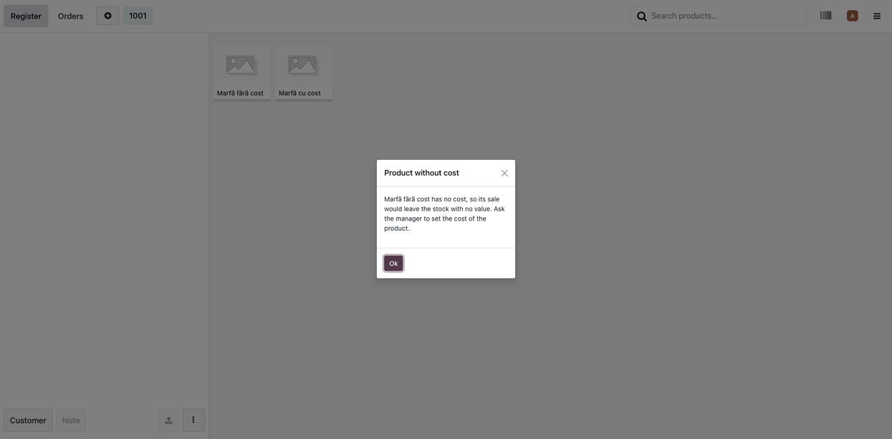

=====================================
Stock Valuation Guard - Point of Sale
=====================================

..
   !!!!!!!!!!!!!!!!!!!!!!!!!!!!!!!!!!!!!!!!!!!!!!!!!!!!
   !! This file is generated by oca-gen-addon-readme !!
   !! changes will be overwritten.                   !!
   !!!!!!!!!!!!!!!!!!!!!!!!!!!!!!!!!!!!!!!!!!!!!!!!!!!!
   !! source digest: sha256:f341bb844ea7fbee01cfb09421065bf9f32c6e4494b60ec23fbba11fddf705e5
   !!!!!!!!!!!!!!!!!!!!!!!!!!!!!!!!!!!!!!!!!!!!!!!!!!!!

.. |badge1| image:: https://img.shields.io/badge/maturity-Beta-yellow.png
    :target: https://odoo-community.org/page/development-status
    :alt: Beta
.. |badge2| image:: https://img.shields.io/badge/github-dhongu%2Fdeltatech_stock_valuation-lightgray.png?logo=github
    :target: https://github.com/dhongu/deltatech_stock_valuation/tree/20.0/deltatech_stock_valuation_guard_pos
    :alt: dhongu/deltatech_stock_valuation
.. |badge_fisa| image:: https://img.shields.io/badge/-Fi%C8%99%C4%83%20consultant-2ea44f.png
    :target: https://github.com/dhongu/deltatech_stock_valuation/blob/20.0/deltatech_stock_valuation_guard_pos/readme/FISA_CONSULTANT.md
    :alt: Fișă consultant

|badge1| |badge2| |badge_fisa|

Point of Sale side of *Stock Valuation Guard*.

The moves of a POS order are validated when the order reaches the
server, after the fiscal receipt was printed. Refusing them there would
leave the order stuck in the register, so this module moves the check to
the cart:

- with *Block Unvalued Moves* ticked on the company, a storable product
  without cost cannot be added to an order: the register shows a message
  asking for the cost of the product;
- refunds are not blocked;
- the moves of POS orders are not checked again on the server.

A product template with several variants is checked only when the
variant is given directly (scan, variant card); when the variant is
chosen in the configurator, the product shows up in the control lists of
*Stock Valuation Guard* instead.

The module is installed automatically with *Stock Valuation Guard* and
*Point of Sale*.

**Table of contents**

.. contents::
   :local:

Usage
=====

1. Tick *Block Unvalued Moves* in *Inventory > Configuration >
   Settings*, section *Valuation* (module *Stock Valuation Guard*).
   Registers opened before need a reload.

2. In the register, a storable product without cost cannot be added to
   the order: the register shows *Product without cost* and the cart
   stays as it was. Ask the manager to set the cost of the product, then
   reload the register.

   |The register with the Product without cost message over the product
   list|

Refunds, consumables and services are not blocked. A variant chosen in
the variant configurator is not checked; it shows up in the control
lists of *Stock Valuation Guard*.

Changelog
=========

20.0.1.0.2 (2026-11-04)
-----------------------

- Migration to Odoo 20: depends on ``pos_stock``, where the link between
  the POS and the stock pickings now lives; the hoot tests use
  ``definePosStockModels`` and the Python tests use ``uom_id`` on stock
  moves; Apps banner and page regenerated for Odoo 20.

19.0.1.0.2 (2026-11-04)
-----------------------

- Consultant sheet (``readme/FISA_CONSULTANT.md``), usage notes and
  screenshot.

19.0.1.0.1 (2026-10-23)
-----------------------

- Main image for the Odoo Apps Store (banner); the manifest points to it
  in ``images``.

19.0.1.0.0 (2026-10-21)
-----------------------

- First version: a storable product without cost is stopped at the POS
  cart; the moves of POS orders are not checked again on the server.

Bug Tracker
===========

Bugs are tracked on `Terrabit Issues <https://www.terrabit.ro/helpdesk>`_.
In case of trouble, please check there if your issue has already been reported.

Do not contact contributors directly about support or help with technical issues.

Credits
=======

Authors
-------

* Terrabit
* Dorin Hongu

Maintainers
-----------

.. |maintainer-dhongu| image:: https://github.com/dhongu.png?size=40px
    :target: https://github.com/dhongu
    :alt: dhongu

Current maintainer:

|maintainer-dhongu| 

This module is part of the `dhongu/deltatech_stock_valuation <https://github.com/dhongu/deltatech_stock_valuation/tree/20.0/deltatech_stock_valuation_guard_pos>`_ project on GitHub.

You are welcome to contribute.